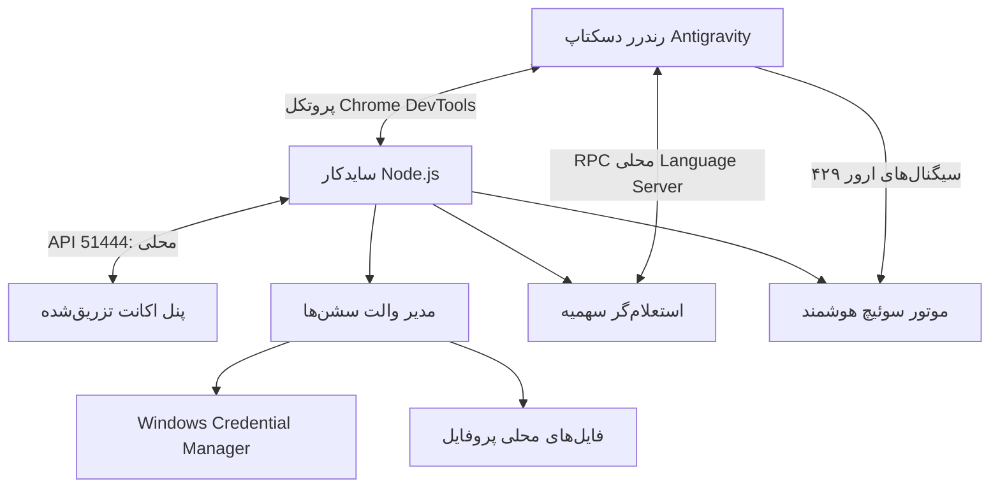

<div align="center">
  
  <br />
  <h1>Antigravity Account Switcher (نسخه فارسی)</h1>
  <p><strong>مدیریت و جابه‌جایی سریع بین چندین اکانت گوگل به‌صورت نیتیو از داخل محیط دسکتاپ Antigravity</strong></p>
  <p>
    <a href="README.md">English</a> · <strong>فارسی</strong>
  </p>
  <p>
    <a href="https://github.com/sohrabezzati/antigravity-account-switcher"></a>
    <a href="https://github.com/sohrabezzati/antigravity-account-switcher/blob/master/LICENSE"></a>
    
    
  </p>
  <p>
    <a href="#ویژگی‌ها">ویژگی‌ها</a> ·
    <a href="#نصب-سریع">نصب سریع</a> ·
    <a href="#نحوه-استفاده">نحوه استفاده</a> ·
    <a href="#دستورات-cli">دستورات CLI</a> ·
    <a href="#امنیت-و-حفظ-داده‌ها">امنیت و داده‌ها</a>
  </p>
</div>

---

## ⚡ این ابزار چه کاری انجام می‌دهد؟

**Antigravity Account Switcher** یک افزونه و سایدکار اختصاصی ویندوز برای نرم‌افزار Google Antigravity Desktop است. این افزونه یک پنل شیشه‌ای و مدرن را مستقیماً به سایدبار نرم‌افزار تزریق می‌کند، سشن‌های رسمی گوگل شما را به شکل امن ذخیره می‌سازد و به شما اجازه می‌دهد بدون نیاز به باز کردن پنجره‌های جداگانه یا لاگین مجدد خسته‌کننده، اکانت فعال خود را با ۱ کلیک تغییر دهید.

<div align="center">
  
  <p><em>پنل گلس‌مورفیک کریستالی با تلمتری لحظه‌ای سهمیه‌ها، تایمر شمارش معکوس و جابه‌جایی ۱ کلیکی.</em></p>
</div>

یک سرویس سایدکار سبک Node.js از طریق پروتکل رسمی Chrome DevTools Protocol (CDP) به رندرر آنتی‌گرویتی متصل می‌شود. این سرویس والت سشن‌ها را هماهنگ می‌کند، سهمیه‌ها را مستقیماً از طریق Language Server داخلی خودِ برنامه استعلام می‌نماید و در صورت اتمام سهمیه، امکان جابه‌جایی خودکار به اکانت‌های رزرو را فراهم می‌کند.

> [!IMPORTANT]
> این نسخه برای **ویندوز ۱۰ و ۱۱** توسعه یافته است و کرنشال‌ها را مستقیماً از طریق **Windows Credential Manager** و مسیرهای رسمی `%APPDATA%` مدیریت می‌کند.

---

## ✨ ویژگی‌ها

| قابلیت | مزیت برای شما |
| :--- | :--- |
| **پنل درون‌برنامه‌ای (In-App)** | تعبیه مستقیم دکمه جابه‌جایی درست روبه‌روی آیکون Settings بدون ترک محیط کدنویسی. |
| **والت محلی سشن‌ها** | ذخیره امن اسنپ‌شات سشن‌های گوگل، نام‌گذاری پروفایل‌ها و مدیریت آنها بدون پراکسی. |
| **سوئیچ ایمن و ۱-کلیک** | انتخاب اکانت، آپدیت اتمیک کرنشال ویندوز و ریلود نرم رندرر در کمتر از ۲ ثانیه. |
| **تلمتری زنده سهمیه‌ها** | نمایش درصد باقیمانده سهمیه ۵ ساعته و استخر هفتگی به همراه تایمر دقیق ریست. |
| **سوئیچ هوشمند (Auto-Switch)** | چرخش خودکار به اکانت با بیشترین سهمیه به محض دریافت ارور اتمام سهمیه (HTTP 429). |
| **خط فرمان (CLI)** | دستورات سریع ترمینال برای مشاهده اکانت‌ها، سوئیچ با ایمیل، بکاپ و بررسی آپدیت. |
| **۱۰۰٪ بدون پراکسی و ایمن** | هیچ ترافیکی از سرور واسط یا پراکسی محلی عبور نمی‌کند؛ خطر بن شدن صفر است. |

---

## 🚀 نصب سریع

### روش ۱: اجرای یک‌خطی با npx (پیشنهادی — بدون نیاز به کلون)

نصب و اتصال مستقیم به آنتی‌گرویتی تنها با یک دستور:
```powershell
npx antigravity-account-switcher install
```

جهت به‌روزرسانی به آخرین نسخه منتشرشده:
```powershell
npx antigravity-account-switcher update
```

بررسی وضعیت اتصال سایدکار و سلامت اکانت‌ها:
```powershell
npx antigravity-account-switcher status
```

### روش ۲: نصب گام‌به‌گام از سورس‌کد (Source Code)

نصب مستقیم از سورس‌کد برای توسعه‌دهندگان، اعمال شخصی‌سازی‌ها، یا محیط‌های آفلاین عالی است:

#### ۱. پیش‌نیازها
- **گیت (Git)** و **Node.js 22.4+** یا جدیدتر.
- نصب حداقل یک‌بار نرم‌افزار Google Antigravity Desktop یا Antigravity IDE.
- در لینوکس: `libsecret` (فدورا: `sudo dnf install libsecret` | اوبونتو: `sudo apt install libsecret-tools gnome-keyring`).

#### ۲. کلون مخزن گیت‌هاب
```bash
git clone https://github.com/sohrabezzati/antigravity-account-switcher.git
cd antigravity-account-switcher
```

#### ۳. نصب وابستگی‌ها و اجرای تست‌ها
```bash
npm install
npm test
```

#### ۴. استقرار خودکار افزونه در آنتی‌گرویتی
```bash
npm run install-plugin
```

این دستور به شکل خودکار:
- افزونه را در مسیر `~/.gemini/config/plugins/antigravity-account-switcher` (یا `%USERPROFILE%\.gemini\...` در ویندوز) مستقر می‌سازد.
- مهارت `account-switcher` را برای `antigravity-cli` فعال می‌کند.
- پنجره باز Antigravity را بدون ری‌استارت با هات‌ریلود زنده فعال می‌کند.

#### ۵. آپدیت از سورس‌کد
```bash
git pull origin master
npm run install-plugin
```

#### ۶. حذف افزونه از سورس‌کد
```bash
npm run uninstall-plugin
```

---

## 💡 نحوه استفاده

1. نرم‌افزار Antigravity را باز کنید؛ دکمه دایره‌ای افزونه را در پایین سایدبار روبه‌روی آیکون **Settings** مشاهده می‌کنید.
2. با کلیک روی آن، پنل باز می‌شود و سهمیه زنده اکانت جاری را به همراه تایمر ریست نمایش می‌دهد.
3. با زدن دکمه **Add Account** سشن جاری ذخیره شده و فرم ورود رسمی گوگل برای افزودن اکانت جدید باز می‌شود.
4. برای تغییر اکانت، کافی است روی دکمه **Switch** هر اکانت کلیک کنید تا کمتر از ۲ ثانیه پنجره ریلود شود.
5. کلید **Auto-Switch** را فعال کنید تا در پروژه‌های سنگین کدنویسی، به محض ۴۲۹ شدن، کار شما بدون وقفه ادامه یابد.

---

## 💻 دستورات CLI

دستورات را می‌توانید با `npx antigravity-account-switcher <دستور>` اجرا کنید:

| دستور | شرح عملکرد |
| :--- | :--- |
| `npx antigravity-account-switcher list` | لیست تمام پروفایل‌های ذخیره شده و وضعیت سهمیه‌ها |
| `npx antigravity-account-switcher switch <email>` | سوئیچ به اکانت مورد نظر بر اساس ایمیل یا شناسه |
| `npx antigravity-account-switcher snapshot "Work"` | ذخیره اسنپ‌شات سشن فعلی با برچسب دلخواه |
| `npx antigravity-account-switcher status` | وضعیت اتصال سایدکار، نسخه نصب‌شده و تعداد اکانت‌ها |
| `npx antigravity-account-switcher logs 100` | نمایش ۱۰۰ خط آخر لاگ‌های سایدکار |
| `npx antigravity-account-switcher check-update` | بررسی انتشار نسخه جدیدتر در npm و گیت‌هاب |
| `npx antigravity-account-switcher start` | اجرای دستی سرویس سایدکار |
| `npx antigravity-account-switcher uninstall` | حذف نصب افزونه از آنتی‌گرویتی |

---

## 🛡️ معماری سیستم



---

## 🔒 امنیت و حفظ داده‌ها

> [!WARNING]
> اسنپ‌شات‌های سشن ذخیره‌شده به شکل داده‌های محلی در سیستم شما نگهداری می‌شوند. این فایل‌ها حاوی اعتبار دسترسی شما هستند؛ از اشتراک‌گذاری یا آپلود پوشه والت خودداری کنید.

| داده | مسیر نگهداری در سیستم شما |
| :--- | :--- |
| ایندکس پروفایل‌ها | `~/.gemini/antigravity-switcher/vault/profiles.json` |
| اسنپ‌شات سشن‌های ذخیره شده | `~/.gemini/antigravity-switcher/vault/sessions/` |
| سشن فعال جاری ویندوز | Windows Credential Manager — `LegacyGeneric:target=gemini:antigravity` |
| متادیتای ایمیل فعال | `%APPDATA%\Antigravity\app_storage.json` |

---

## 📄 لایسنس

این پروژه تحت لایسنس [MIT License](LICENSE) منتشر شده و کاملاً متن‌باز است.

---

<div align="center">
  <sub>طراحی‌شده برای توسعه‌دهندگانی که می‌خواهند اکانت عوض کنند — نه تمرکزشان را.</sub>
</div>
