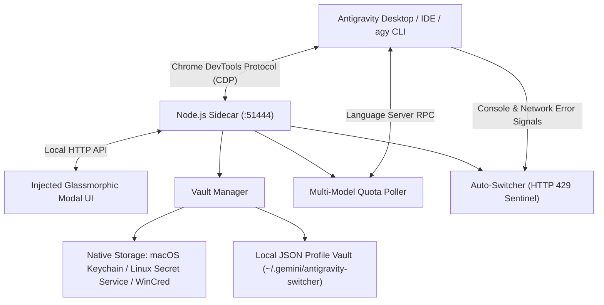

<div align="center">
  
  <br />
  <h1>Antigravity Account Switcher</h1>
  <p><strong>Seamless multi-account manager & real-time quota telemetry across macOS, Linux, and Windows.</strong></p>
  <p>
    <strong>English</strong> · <a href="README.fa.md">فارسی</a>
  </p>
  <p>
    <a href="https://github.com/sohrabezzati/antigravity-account-switcher"></a>
    <a href="https://github.com/sohrabezzati/antigravity-account-switcher/blob/master/LICENSE"></a>
    
    
    
  </p>
  <p>
    <a href="#features">Features</a> ·
    <a href="#cross-platform-installation-guide">Install Guide</a> ·
    <a href="#platform-specific-prerequisites">Platform Setup</a> ·
    <a href="#using-the-switcher-gui">GUI Usage</a> ·
    <a href="#cli-and-agy-workflows">CLI & agy</a> ·
    <a href="#architecture-and-security">Security</a>
  </p>
</div>

---

## What it does

**Antigravity Account Switcher** is an all-in-one cross-platform account manager and live quota watcher engineered for **Google Antigravity Desktop**, **Antigravity IDE**, and **`antigravity-cli` (`agy`)**. It injects a native tactile glassmorphic dashboard into the sidebar, manages local encrypted snapshots of Google sessions, preserves active chat conversations across restarts, and provides instant zero-downtime switching across **macOS**, **Linux (Fedora, Ubuntu, Debian, Arch)**, and **Windows**.

<div align="center">
  
  <p><em>In-app glassmorphic modal with real-time multi-model telemetry (Gemini, Claude/GPT, and Argon), countdown timers, and 1-click account swap.</em></p>
</div>

A lightweight Node.js sidecar interfaces directly with Antigravity via Chrome DevTools Protocol (CDP) and local Language Server RPCs. It coordinates the local account vault, captures live quota information across individual model tiers, and automatically preserves active TanStack Router conversations (`/c/$cascadeId`) so you never lose context when switching.

---

## Features

| Feature | What you get |
| --- | --- |
| **Cross-Platform Native** | Fully supported on **macOS** (macOS Keychain), **Linux Fedora / Ubuntu / Debian / Arch** (Secret Service), and **Windows 10/11** (Windows Credential Manager). |
| **Separate Multi-Model Quotas** | Dedicated, categorized live telemetry gauges for: <br>• 🔷 **Gemini Models** (Flash & Pro rolling 5-hour limit + weekly pool)<br>• 🟣 **Claude & GPT 3rd-Party Models** (Claude 3.7 / 3.5 Sonnet, Opus, GPT-OSS)<br>• ⚡ **Gemini 4 Argon** (Deep Reasoning WTU limit) |
| **Active Session Cockpit** | Bento-styled live cockpit displaying user profile avatar, display name, full email address, plan badge (Pro/Teams/Free), and 1-click email copy. |
| **Conversation Preservation** | Preserves active chat cascade routes (`/c/$cascadeId`) across account swaps; prevents blank landing page resets or lost conversations. |
| **Terms of Service Suppression** | Automatically bypasses repetitive "Accept Terms of Service" and "Security Notice" popups on session restart. |
| **antigravity-cli (`agy`) Integration** | Native CLI subcommand `agy` and an integrated `account-switcher` skill for multi-account management in terminal workflows. |
| **Standby Accounts Vault** | View all standby reserve accounts at a glance with live multi-model quota percentages and 1-click "Switch" buttons. |
| **Auto-Switch on Rate Limit (HTTP 429)** | Optional automated rotation: seamlessly switches to the next healthiest standby account when an active quota is exhausted. |
| **Direct & Zero-Proxy Architecture** | Does not proxy model network traffic; reads quota metrics straight from the local Antigravity Language Server interface. |

---

## Cross-Platform Installation Guide

### Option 1: 1-Line Universal Installers (Recommended — Zero Dependency)

#### On macOS & Linux (Fedora, Ubuntu, Debian, Arch):
Run in your terminal (bash/zsh):
```bash
curl -fsSL https://raw.githubusercontent.com/sohrabezzati/antigravity-account-switcher/master/install.sh | bash
```

#### On Windows (PowerShell):
Run in PowerShell:
```powershell
irm https://raw.githubusercontent.com/sohrabezzati/antigravity-account-switcher/master/install.ps1 | iex
```

---

### Option 2: 1-Line npm / npx (Zero Clone Needed)

Install via npm registry with a single command across any platform:
```bash
npx antigravity-account-switcher install
```

To update to the latest release with live hot-reload:
```bash
npx antigravity-account-switcher update
```

Check system status and live account health:
```bash
npx antigravity-account-switcher status
```

---

### Option 3: Install from Source

```bash
git clone https://github.com/sohrabezzati/antigravity-account-switcher.git
cd antigravity-account-switcher
npm run install-plugin
```

The plugin deploys automatically to your local Antigravity plugins directory:
- **macOS / Linux**: `~/.gemini/config/plugins/antigravity-account-switcher`
- **Windows**: `%USERPROFILE%\.gemini\config\plugins\antigravity-account-switcher`

---

## Platform-Specific Prerequisites

### 🍏 macOS (Apple Silicon & Intel)
- **Supported Versions**: macOS 12 Monterey, macOS 13 Ventura, macOS 14 Sonoma, macOS 15 Sequoia+.
- **Antigravity Locations**: Supports `/Applications/Antigravity.app` and `/Applications/Antigravity IDE.app`.
- **Credential Storage**: Uses the native macOS Keychain (`security` utility) under service `antigravity`. No additional packages required.

### 🐧 Linux (Fedora, RHEL, CentOS)
- **Supported Versions**: Fedora 38, 39, 40+, RHEL 9+.
- **Package Requirement**: Requires `libsecret` for Secret Service credential management:
  ```bash
  sudo dnf install libsecret
  ```
- **CLI Workflows**: Fully compatible with `antigravity-cli` (`agy`).

### 🐧 Linux (Ubuntu, Debian, Pop!_OS, Mint)
- **Supported Versions**: Ubuntu 22.04 LTS, 24.04 LTS+, Debian 12+.
- **Package Requirement**: Requires `libsecret-tools` and `gnome-keyring`:
  ```bash
  sudo apt update && sudo apt install libsecret-tools gnome-keyring
  ```

### 🐧 Linux (Arch Linux, Manjaro)
- **Package Requirement**: Requires `libsecret`:
  ```bash
  sudo pacman -S libsecret
  ```

### 🪟 Windows (10 & 11)
- **Credential Storage**: Uses the native Windows Credential Manager under `LegacyGeneric:target=gemini:antigravity`.
- **PowerShell**: PowerShell 5.1+ or PowerShell 7+ with access to user credentials.

---

## Using the Switcher (GUI)

1. **Locate the Trigger Button**: Open Antigravity (or Antigravity IDE) and locate the circular Google Account avatar button in the bottom sidebar (directly opposite the **Settings** gear icon).
2. **Review Live Quotas**: Open the popover to inspect your active session. Quotas are broken down across **Gemini**, **Claude/GPT**, and **Argon** with countdown timers for 5-hour rolling limits and weekly refresh pools.
3. **Add Accounts**: Click **Add Account** to snapshot the current session and initiate Google login for a new account inside Antigravity.
4. **Switch Accounts**: Click **Switch** next to any standby account. A persistent activation dialog will appear while your credentials are safely written to native storage and the language server session mounts.
5. **Chat History Stays Intact**: Antigravity reloads cleanly into your active conversation (`/c/$cascadeId`) without dropping you back to the root landing page.
6. **Auto-Switch**: Toggle **Auto-Switch** in the dock if you want the sidecar to automatically cycle to the standby account with the highest remaining quota upon encountering an HTTP 429 rate limit.

---

## CLI and `agy` Workflows

You can manage accounts directly from your terminal using `npx antigravity-account-switcher <command>` (or `agy` if you have `antigravity-cli` installed):

| Command | Description |
| --- | --- |
| `npx antigravity-account-switcher list` | List all saved accounts with separate Gemini, Claude/GPT, and Argon quotas. |
| `npx antigravity-account-switcher quota` | Display a terminal ASCII quota dashboard across all model categories. |
| `npx antigravity-account-switcher switch <email-or-id>` | Switch the active account in native system credential storage. |
| `npx antigravity-account-switcher agy` | Check `antigravity-cli` (`agy`) daemon status and skill integration. |
| `npx antigravity-account-switcher snapshot "Work"` | Take a snapshot of the current active session with a custom label. |
| `npx antigravity-account-switcher status` | Inspect sidecar health, platform OS, active port, and vault statistics. |
| `npx antigravity-account-switcher logs 50` | Print recent runtime sidecar logs for diagnostics. |
| `npx antigravity-account-switcher update` | Fetch and apply the latest release with live hot-reload. |

---

## Multi-Model Quota Breakdown

Antigravity categorizes compute limits into distinct buckets. This switcher queries and displays all three independently:

```text
┌────────────────────────────────────────────────────────────────────────┐
│  ACTIVE ACCOUNT: user@example.com (PRO)                                │
├────────────────────────────────────────────────────────────────────────┤
│  🔷 GEMINI FLASH & PRO                                                 │
│     5-Hour Rolling Limit: [████████████████░░░░] 85% (Resets in 3h 15m)│
│     Weekly Pool:          [██████████████████░░] 92% (Resets in 5d 20h)│
├────────────────────────────────────────────────────────────────────────┤
│  🟣 CLAUDE & GPT (3rd-Party Models)                                    │
│     Claude 3.7 / 3.5 Sonnet, Claude Opus, GPT-OSS                      │
│     Weekly Pool:          [████████████████████] 100% (Ready)          │
├────────────────────────────────────────────────────────────────────────┤
│  ⚡ GEMINI 4 ARGON (WTU Deep Reasoning)                                │
│     Weekly Limit:         [████████████████░░░░] 84% (Resets in 5d 20h)│
└────────────────────────────────────────────────────────────────────────┘
```

---

## Architecture and Security



### Credential & Data Storage Locations

| Data | Location |
| --- | --- |
| **Profile Index** | `~/.gemini/antigravity-switcher/vault/profiles.json` |
| **Saved Session Snapshots** | `~/.gemini/antigravity-switcher/vault/sessions/*.json` |
| **Active macOS Credential** | macOS Keychain — Service: `antigravity` |
| **Active Linux Credential** | Secret Service API — Service: `antigravity` |
| **Active Windows Credential** | Windows Credential Manager — `LegacyGeneric:target=gemini:antigravity` |
| **Active Account Metadata** | Antigravity `app_storage.json` |

> [!WARNING]
> Saved session snapshots contain Google OAuth session tokens stored in your user directory. Treat your local vault directory as confidential. Never commit session JSON files or share debug logs publicly.

---

## Troubleshooting

- **Avatar button does not appear in sidebar**: Reload the Antigravity window (`Cmd+R` / `Ctrl+R`) or run `npx antigravity-account-switcher status`. Ensure the sidecar is running on port `51444`.
- **Linux: "secret-tool: command not found"**: Install `libsecret` on Fedora (`sudo dnf install libsecret`) or `libsecret-tools` on Ubuntu/Debian (`sudo apt install libsecret-tools`).
- **Quota values show 100% or "Active"**: Saved standby accounts show their last known quota snapshot. Click **Refresh** inside the panel or run `npx antigravity-account-switcher switch <email>` to query live language server metrics.
- **Port conflicts**: The sidecar uses default port `51444`. If occupied, check running processes with `lsof -i :51444` (macOS/Linux) or `netstat -ano | findstr 51444` (Windows).

---

## Development & Testing

```bash
# Run unit tests across vault, platform paths, and route restoration
npm test

# Run the sidecar in standalone debug mode
npm start
```

---

## License

Released under the [MIT License](LICENSE).

<div align="center">
  <sub>Built for developers who switch accounts — not context.</sub>
</div>
