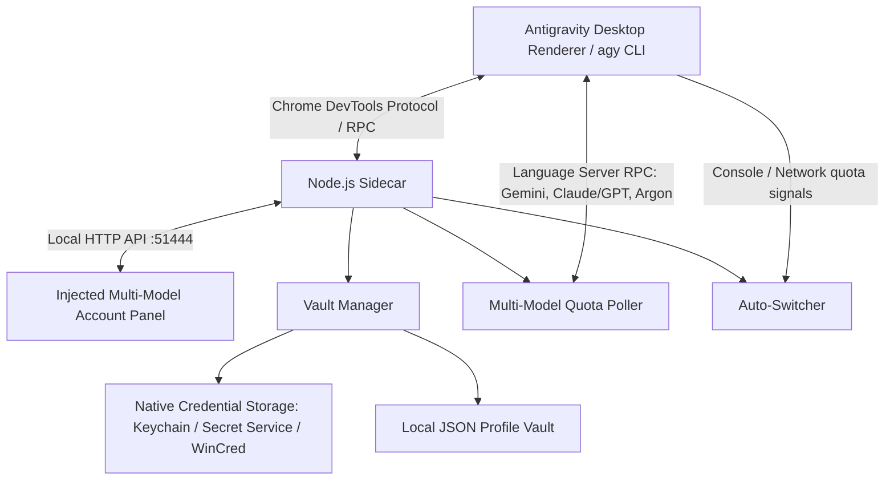

<div align="center">
  
  <br />
  <h1>Antigravity Account Switcher</h1>
  <p><strong>Manage multiple Google accounts from inside Google Antigravity.</strong></p>
  <p>
    <strong>English</strong> · <a href="README.fa.md">فارسی</a>
  </p>
  <p>
    <a href="https://github.com/omid-io/antigravity-account-switcher"></a>
    <a href="https://github.com/omid-io/antigravity-account-switcher/blob/master/LICENSE"></a>
    
    
  </p>
  <p>
    <a href="#features">Features</a> ·
    <a href="#quick-start">Quick start</a> ·
    <a href="#using-the-switcher">Usage</a> ·
    <a href="#cli-reference">CLI</a> ·
    <a href="#security-and-data">Security</a>
  </p>
</div>

---

## What it does

**Antigravity Account Switcher** is a cross-platform account manager and live quota watcher for **Google Antigravity Desktop**, **Antigravity IDE**, and **antigravity-cli (`agy`)**. It adds an in-app account panel into the sidebar, keeps local encrypted snapshots of Google sessions, and allows you to seamlessly switch the active account across **macOS**, **Linux (Fedora, Ubuntu, Debian, Arch)**, and **Windows**.

<div align="center">
  
  <p><em>In-app glassmorphic modal with real-time multi-model telemetry (Gemini, Claude/GPT, and Argon), countdown timers, and 1-click account swap.</em></p>
</div>

A lightweight Node.js sidecar connects to the Antigravity renderer through the Chrome DevTools Protocol (CDP). It coordinates the local account vault, reads quota information exposed by Antigravity's local Language Server, and can optionally react to quota-exhaustion signals.

> [!NOTE]
> **Cross-Platform Support**: Works out-of-the-box on **macOS** (macOS Keychain), **Linux Fedora / Ubuntu / RHEL** (Secret Service / `secret-tool`), and **Windows 10/11** (Windows Credential Manager). It also provides native skill integration for `antigravity-cli` (`agy`).

## Features

| Feature | What you get |
| --- | --- |
| **In-app account panel** | An account launcher and dashboard injected into the Antigravity desktop renderer sidebar next to Settings. |
| **Separate Model Quotas** | Dedicated, categorized live quota gauges for **Gemini Models** (Flash/Pro), **Claude & GPT 3rd-Party Models** (Sonnet/Opus/GPT), and **Gemini 4 Argon** (Deep Reasoning WTU). |
| **Local account vault** | Save session snapshots, keep multiple account profiles, and rename or remove saved profiles. |
| **Confirmed account switching** | Select a saved account, confirm the change, update the native credential manager, and trigger zero-downtime Language Server restart and renderer reload. |
| **antigravity-cli (`agy`) Support** | Native CLI subcommand `agy` and an integrated `agy` skill for multi-account management in terminal workflows. |
| **Optional auto-switch** | When enabled, react to detected HTTP 429 / quota-exhaustion signals and select an eligible standby account. |
| **CLI Dashboard** | List accounts with multi-model quotas, switch by email or ID, inspect rich terminal ASCII quota meters, and check for updates. |
| **No model-traffic proxy** | The project does not implement a third-party proxy for model requests; quota reads use Antigravity's local Language Server interface. |

### A note about quota data

The active account is queried through Antigravity's local Language Server RPC when the panel refreshes. Saved inactive accounts are displayed from their **most recently stored quota snapshot**; their values are not independently refreshed while they are inactive. The panel refreshes on open, on demand, and periodically while it remains open.

### How auto-switch works

Auto-switch is **off by default**. When enabled, the CDP bridge watches renderer console messages and network responses for quota-exhaustion signals such as `429`, `quota exceeded`, or `resource_exhausted`. It then considers inactive profiles marked `ready` with more than 10% remaining in **both** the 5-hour and weekly buckets, excluding accounts that need re-authentication. The account with the highest 5-hour remainder is preferred, with weekly remainder used as the tie-breaker.

This is best-effort event detection, not a guarantee that every quota error will be detected or that a request will always continue uninterrupted. The toggle is runtime state and returns to off when the sidecar restarts.

## Quick start

### Requirements

- Windows 10 or Windows 11.
- Google Antigravity Desktop installed and signed in at least once.
- Node.js **22.4+ recommended** for stable built-in WebSocket support used by the CDP bridge. `package.json` currently declares `node >=18`, but older Node versions may require the experimental WebSocket flag or may not support the CDP connection as expected.
- PowerShell and access to the current Windows user's Credential Manager.

### Option 1: 1-Line Native Windows PowerShell (Recommended — Zero Dependency)

Install or update directly from PowerShell with zero prerequisites (no npm, git, or clone needed):

```powershell
irm https://raw.githubusercontent.com/omid-io/antigravity-account-switcher/master/install.ps1 | iex
```

### Option 2: 1-Line npm / npx (Zero Clone Needed)

Install via npm registry with a single command:
```powershell
npx antigravity-account-switcher install
```

To update to the latest release with live hot-reload:
```powershell
npx antigravity-account-switcher update
```

Check system status and live account health:
```powershell
npx antigravity-account-switcher status
```

### Option 3: Install from source

```powershell
git clone https://github.com/omid-io/antigravity-account-switcher.git
cd antigravity-account-switcher
npm run install-plugin
```

The installer installs the project into:

```text
%USERPROFILE%\.gemini\config\plugins\antigravity-account-switcher
```

### Option 4: Antigravity Marketplace Card

For users inside Antigravity with marketplace integration enabled, invoke via:
```html
<plugin-card catalog-id="antigravity-account-switcher"></plugin-card>
```

It also attempts to inject the updated UI into a running Antigravity window. On a first install, or when live reload is unavailable, restart Antigravity or reload its window.

To remove the installed plugin later:

```powershell
npm run uninstall-plugin
```

## Using the switcher

1. Open Antigravity and locate the circular account-switcher control in the sidebar area (positioned directly opposite the **Settings** gear icon).
2. Open the panel to review the active account and saved profiles. Use **Refresh** to request an updated quota snapshot.
3. Choose **Add Account** to snapshot the current session and start the Google sign-in flow for another account. Complete sign-in inside Antigravity.
4. To change accounts, select a saved profile and confirm the switch. When the CDP bridge is connected, the sidecar also requests a Language Server restart and reloads the Antigravity renderer.
5. Turn on **Auto-Switch** only when you explicitly want the sidecar to react to detected quota-exhaustion events.

> **One active account at a time:** this project switches the active session in one Antigravity installation. It does not run multiple isolated Antigravity sessions concurrently or combine account quotas.

## CLI reference

Run commands via `npx antigravity-account-switcher <command>` (or `node bin/cli.js <command>` when working in the cloned repo):

| Command | Description |
| --- | --- |
| `npx antigravity-account-switcher list` | List saved profiles with separate Gemini, Claude/GPT, and Argon quotas. |
| `npx antigravity-account-switcher quota` | Show rich terminal ASCII quota dashboard across Gemini, Claude/GPT, and Argon. |
| `npx antigravity-account-switcher switch <email-or-id>` | Switch active Google account in the native credential manager. |
| `npx antigravity-account-switcher agy` | Inspect `antigravity-cli` (`agy`) integration status and background daemon. |
| `npx antigravity-account-switcher snapshot "Work Account"` | Save or update a snapshot of the current session with a label. |
| `npx antigravity-account-switcher status` | Show sidecar connection, platform OS, installed version, and vault count. |
| `npx antigravity-account-switcher logs 100` | Print the most recent 100 log lines. |
| `npx antigravity-account-switcher check-update` | Check the configured update sources for a newer version. |
| `npx antigravity-account-switcher start` | Start the sidecar manually. |
| `npx antigravity-account-switcher uninstall` | Remove the installed plugin. |
| `npx antigravity-account-switcher --help` | Show CLI help. |

If the sidecar is offline when `switch` is run, the CLI updates the native system credential manager (macOS Keychain, Linux Secret Service, or Windows Credential Manager), and Antigravity/agy will use the new account upon reload.

## How it is put together


    D --> F[Local JSON Profile Vault]
    B --> G[Quota Poller]
    G <-->|Local Language Server RPC| A
    B --> H[Auto-Switcher]
    A -->|Console / Network quota signals| H
```

The sidecar exposes its local API on `127.0.0.1:51444`. The CDP bridge discovers Antigravity's `DevToolsActivePort` file under `%APPDATA%\Antigravity` and connects to the renderer's WebSocket debugger endpoint.

## Security and data

> [!WARNING]
> **Saved session snapshots are stored as plain JSON files and are not encrypted by this application.** Treat the vault as highly sensitive credential material.

| Data | Location |
| --- | --- |
| Profile index | `~/.gemini/antigravity-switcher/vault/profiles.json` |
| Saved session snapshots | `~/.gemini/antigravity-switcher/vault/sessions/` |
| Active Antigravity credential | Windows Credential Manager — `LegacyGeneric:target=gemini:antigravity` |
| Active account email metadata | `%APPDATA%\Antigravity\app_storage.json` |

Keep your Windows user account and device protected. Do not commit, upload, or share the vault, session JSON files, or diagnostic logs without reviewing them for sensitive account information. The project does not claim to make account switching policy-proof or risk-free; use accounts you own and follow the terms that apply to your Google and Antigravity accounts.

The app's version checker may contact the npm registry and GitHub to check for updates. Quota retrieval itself is performed through the Antigravity local Language Server interface.

## Troubleshooting

**The account control does not appear**  
Reload or restart Antigravity, then run `npx antigravity-account-switcher status` (or `node bin/cli.js status`). The CDP bridge looks for `%APPDATA%\Antigravity\DevToolsActivePort`; if Antigravity does not expose that file, live UI injection and reload features may be unavailable.

**Quota values look stale or unavailable**  
Open the panel and press **Refresh** while Antigravity is running. The active account is the one queried live; inactive accounts use their last saved snapshot. A failed local Language Server request can leave the latest active quota unavailable.

**The CLI changed the credential but the UI still shows the old account**  
Check that the sidecar is online with `npx antigravity-account-switcher status`. If the CDP connection is unavailable, restart or reload Antigravity manually after switching.

**Auto-switch did not find a standby profile**  
The candidate needs to be inactive, in `ready` status, not marked for re-login, and above 10% in both quota buckets. Auto-switch must also be enabled in the panel.

## Development

```powershell
# Run the sidecar directly
npm run start

# Run the repository test suite
npm test
```

The tests exercise the local profile vault and session integration. For development, use a dedicated Windows test account/profile rather than a production environment containing credentials you cannot afford to modify.

## License

Released under the [MIT License](LICENSE).

---

<div align="center">
  <sub>Built for developers who switch accounts — not context.</sub>
</div>
